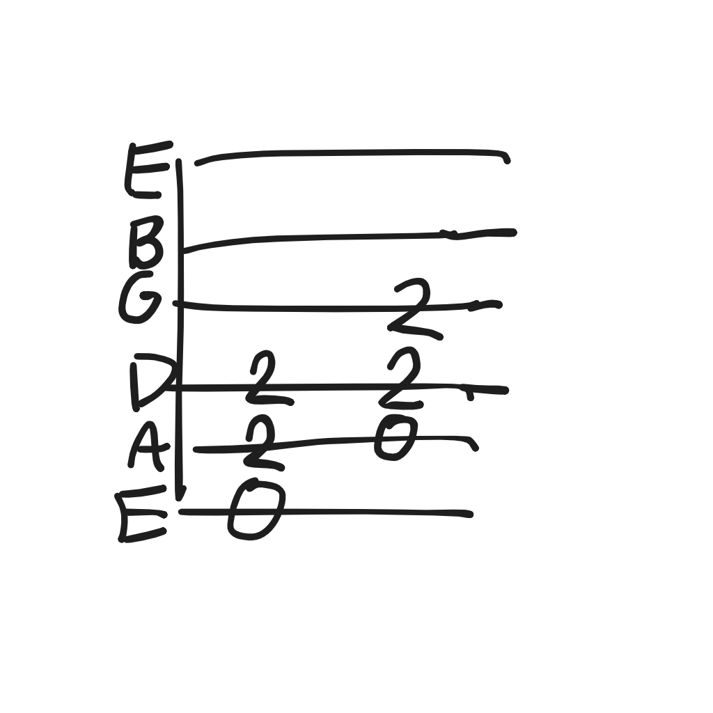

# audiotabs

<p align="center">
  <strong>⚠️ EXTREME WORK IN PROGRESS ⚠️</strong><br>
  <span style="color:#e8a317; font-size:1.1rem;">This app is under active development. Countless bugs exist. 99.9% of features do not work. Unless you are a developer yourself, I would not waste your time here.</span>
</p>

<h1 align="center">
  
</h1>

<p align="center">
  Convert audio to guitar tab PDF (standalone Tab PDF app).
</p>

<p align="center">
  Seeded from the standalone Tab PDF app (`jj_audio_to_tab`), which was copied from the Tab PDF surface of `jj_audio_website`. Both of those stay unchanged; this repo evolves on its own.
</p>

<p align="center">
  <a href="DESKTOP.md"></a>
  <a href="DEPLOY.md"></a>
  <a href="#quickstart"></a>
  <a href="CONTRIBUTING.md"></a>
</p>

<p align="center">
  
  
  
</p>

---

## Quickstart

From a clone:

```bash
make install
make test
```

On Windows:

```powershell
.\scripts\dev.ps1 install
.\scripts\dev.ps1 test
```

---

## Tester

**Windows CPU**
```powershell
$env:AUDIO_TOOLS_EDITOR = "cpu"
.\.venv311\Scripts\python.exe packaging/launcher.py
```

**Windows GPU**
```powershell
$env:AUDIO_TOOLS_EDITOR = "cuda"
.\.venv-desktop\Scripts\python.exe packaging/launcher.py
```

**macOS (Apple Silicon / Intel)**
```bash
python3.11 -m venv .venv311
source .venv311/bin/activate
python -m pip install --upgrade pip
pip install -e ".[demucs,desktop,roformer,separator]"

.venv311/bin/python packaging/launcher.py
```

---

## About

- **Desktop** runs on this computer: Streamlit in `ui/`, started by `packaging/launcher.py`. No Docker.
- **Website** is the hosted app: FastAPI in `backend/` plus the React app in `web/`.
- **Shared engine** lives in `src/audio_to_tab/` (import as `audio_to_tab`).

Python **3.11** (3.10–3.12 only). Desktop installers and the tester app: [DESKTOP.md](DESKTOP.md). Hosted deploy: [DEPLOY.md](DEPLOY.md).

## Table of contents

- [Quickstart](#quickstart)
- [Tester](#tester)
- [About](#about)

## Quickstart

From a clone:

```bash
make install
make test
```

On Windows:

```powershell
.\scripts\dev.ps1 install
.\scripts\dev.ps1 test
```

---

## Tester

**Windows CPU**
```powershell
$env:AUDIO_TOOLS_EDITOR = "cpu"
.\.venv311\Scripts\python.exe packaging/launcher.py
```

**Windows GPU**
```powershell
$env:AUDIO_TOOLS_EDITOR = "cuda"
.\.venv-desktop\Scripts\python.exe packaging/launcher.py
```

**macOS (Apple Silicon / Intel)**
```bash
python3.11 -m venv .venv311
source .venv311/bin/activate
python -m pip install --upgrade pip
pip install -e ".[demucs,desktop,roformer,separator]"

.venv311/bin/python packaging/launcher.py
```