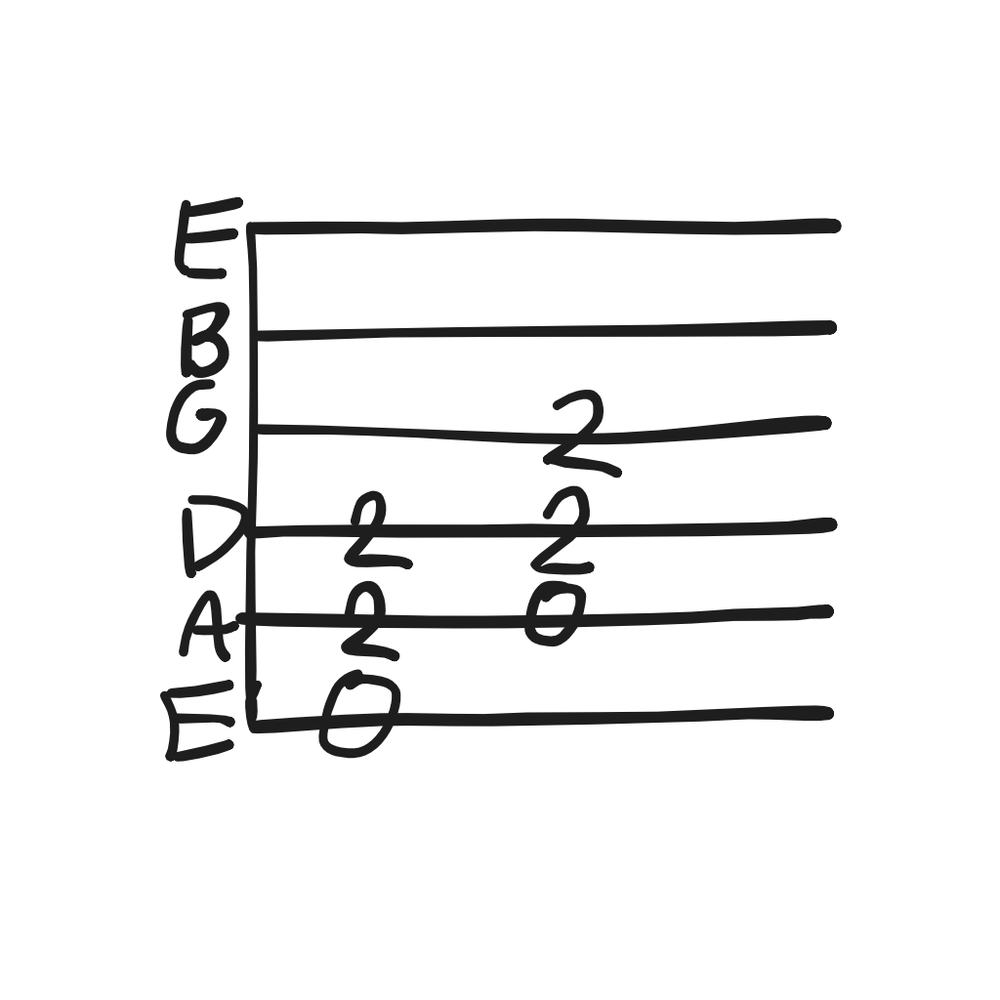

# audiotabs

<p align="center">
  <strong>⚠️ EXTREME WORK IN PROGRESS ⚠️</strong><br>
  <span style="color:#e8a317; font-size:1.1rem;">This app is under active development. Countless bugs exist. 99.9% of features do not work. Unless you are a developer yourself, I would not waste your time here.</span>
</p>

<h1 align="center">
  <!-- Mac/UI use assets/app-icon.png (rounded). Windows desktop uses assets/app-icon.ico (square). -->
  
</h1>

<p align="center">
  Convert audio to guitar tab PDF (standalone Tab PDF app).
</p>

<p align="center">
  Seeded from the standalone Tab PDF app (`jj_audio_to_tab`), which was copied from the Tab PDF surface of `jj_audio_website`. Both of those stay unchanged; this repo evolves on its own.
</p>

<p align="center">
  <a href="DESKTOP.md"></a>
  <a href="DEPLOY.md"></a>
  <a href="#quickstart"></a>
  <a href="CONTRIBUTING.md"></a>
</p>

<p align="center">
  
  
  
</p>

---

## Quickstart

From a clone:

```bash
make install
make test
```

On Windows:

```powershell
.\scripts\dev.ps1 install
.\scripts\dev.ps1 test
```

---

## Tester

**Windows CPU** (once: `py -3.11 -m venv .venv311; .\.venv311\Scripts\python.exe -m pip install -U pip -e ".[demucs,desktop]"`)
```powershell
$env:AUDIO_TOOLS_EDITION = "cpu"
.\.venv311\Scripts\python.exe packaging/launcher.py
```

**Windows GPU** (once: `py -3.11 -m venv .venv-desktop; .\.venv-desktop\Scripts\python.exe -m pip install -U pip -e ".[demucs,desktop,roformer]"`)
```powershell
$env:AUDIO_TOOLS_EDITION = "cuda"
.\.venv-desktop\Scripts\python.exe packaging/launcher.py
```

**macOS (Apple Silicon / Intel)**
```bash
python3.11 -m venv .venv311
source .venv311/bin/activate
python -m pip install --upgrade pip
pip install -e ".[demucs,desktop,roformer,separator]"

.venv311/bin/python packaging/launcher.py
```

---

## About

- **Desktop** runs on this computer: FastAPI + Svelte in `app/`, started by `packaging/launcher.py` (pywebview). No Docker.
- **Shared engine** lives in `src/audio_to_tab/` (import as `audio_to_tab`).
- Build the front end with `make ui-build` before `make desktop` if `app/web/dist` is missing.

### How a conversion runs

1. **Entry** — pick a file, YouTube link or media URL, plus settings (Advanced included).
2. **Instruments** (full mix with stem separation) — the app downloads and trims once,
   separates all six stems once (htdemucs_6s), splits Lead/Rhythm guitar when that engine
   is selected, and lists every instrument with whether it was detected and how sure it is.
   Pick the parts to tab; *Change settings* goes back with your upload intact. Solo guitar,
   separation off, or no separator installed skip this screen (the last one says why).
3. **Tab** — reuses the cached stems (nothing is separated twice). Guitar and bass become
   tab, vocals / piano / other become staff notation, drums become rough kick/snare/hi-hat
   hits. Singing that leaked into the guitar stem is removed by default on full mixes
   (*Advanced → Remove singing that leaks into guitar*).
4. **Result** — show **One part** or **Together** (stacked staves on shared bars, one
   playhead and loop; `T` toggles). The choice is saved with the run. Export the current
   part, or all shown parts as MIDI / MusicXML.

Design and plan: [spec](docs/superpowers/specs/2026-11-25-instrument-parts-design.md) ·
[plan](docs/superpowers/plans/2026-11-25-instrument-parts.md).

Python **3.11** (3.10–3.12 only). Desktop installers and the tester app: [DESKTOP.md](DESKTOP.md). Hosted deploy: [DEPLOY.md](DEPLOY.md).

## Table of contents

- [Quickstart](#quickstart)
- [Tester](#tester)
- [About](#about)

## Quickstart

From a clone:

```bash
make install
make test
```

On Windows:

```powershell
.\scripts\dev.ps1 install
.\scripts\dev.ps1 test
```

---

## Tester

**Windows CPU** (once: `py -3.11 -m venv .venv311; .\.venv311\Scripts\python.exe -m pip install -U pip -e ".[demucs,desktop]"`)
```powershell
$env:AUDIO_TOOLS_EDITION = "cpu"
.\.venv311\Scripts\python.exe packaging/launcher.py
```

**Windows GPU** (once: `py -3.11 -m venv .venv-desktop; .\.venv-desktop\Scripts\python.exe -m pip install -U pip -e ".[demucs,desktop,roformer]"`)
```powershell
$env:AUDIO_TOOLS_EDITION = "cuda"
.\.venv-desktop\Scripts\python.exe packaging/launcher.py
```

**macOS (Apple Silicon / Intel)**
```bash
python3.11 -m venv .venv311
source .venv311/bin/activate
python -m pip install --upgrade pip
pip install -e ".[demucs,desktop,roformer,separator]"

.venv311/bin/python packaging/launcher.py
```